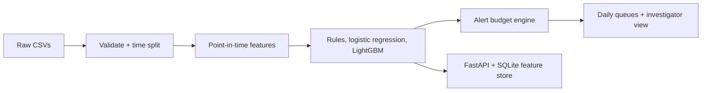
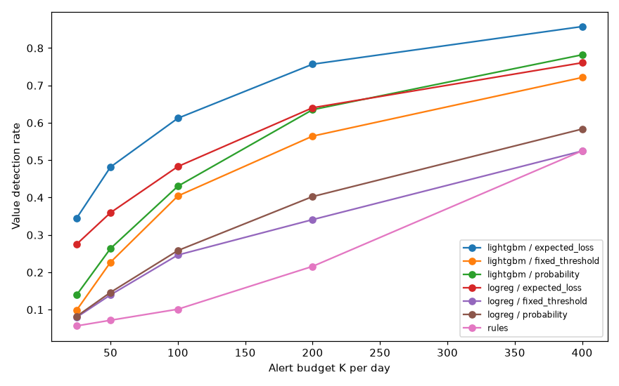

# Fraud detection under a fixed alert budget

A fraud team can review only a fixed number of transactions a day. Fraud is rare, so accuracy is
a poor guide: a model that flags nothing is right about 96.5% of the time. This project answers a
different question: **which K transactions should the team review today to stop the most fraud
money at the lowest cost?**

## Results

IEEE-CIS data, TEST period (the last 29 days, untouched by training and tuning), 100 alerts a day.
First pass with 5 tuning trials.

| Model and policy | Precision@100 | Fraud value caught (VDR) | Net benefit, 29 days |
|---|---|---|---|
| **LightGBM, expected loss** (recommended) | 30.4% | **61.2%** | **₹20,133,586** |
| LightGBM, probability | 48.8% | 43.0% | ₹14,021,433 |
| LightGBM, fixed threshold | 48.8% | 40.4% | ₹13,193,298 |
| Logistic regression, expected loss | 21.4% | 48.3% | ₹15,758,510 |
| Rules baseline | 7.3% | 10.1% | ₹2,848,852 |

Read these with care:

- **Costs are assumptions, not measurements** (set in `config/config.yaml`): ₹150 per review, ₹50
  friction per false alert, 90% of alerted fraud value recovered, ₹85 per dataset unit.
- The recommended setup is picked on TEST, as the specification requires, so it is likely to be
  somewhat optimistic.
- The rules baseline is weak (ROC-AUC 0.55), which flatters the gap to it.
- Ranking by expected loss catches more money but a lower share of its alerts are fraud.
- A fixed threshold exceeded capacity on 14 of the 29 days, by up to 55 alerts.

| Check | Target | Actual |
|---|---|---|
| LightGBM PR-AUC | at least 0.45 | 0.518 |
| LightGBM ROC-AUC | at least 0.88 | 0.899 |
| VDR above rules | at least 10 points | 51.1 points |
| Score drift (PSI), TRAIN to TEST | below 0.25 | 0.038 |
| API features against batch, 2,000 transactions | within 1e-6 | 0 mismatches |
| API latency p95, in process, 1,000 requests | below 100 ms | 85 ms |
| Full pipeline on an 8 GB laptop | below 60 min on 16 GB | about 56 min |

## Why a time split

A bank scores transactions that happen after its training data. A random split puts the same
account on both sides and flatters the model. The pipeline splits by day with a 7-day gap, and
trains one extra model on a random split only to show the difference. On this data the random split reports a PR-AUC of 0.848, against 0.518 for the time split.

## Reproduce

Needs [uv](https://docs.astral.sh/uv/). GNU make is optional: without it, run the command listed
under each target in the `Makefile`.

1. Accept the rules of the Kaggle competition "IEEE-CIS Fraud Detection", download the data and
   unzip the CSV files into `data/raw/`. Only the two `train_*` files are required. The `test_*`
   files add a drift check and need noticeably more memory.
2. Run:

       make setup      # uv sync
       make data       # check the files are there
       make pipeline   # everything, end to end
       make api        # http://localhost:8000
       make app        # investigator view

`make smoke` runs the whole pipeline on synthetic data under `build/smoke/`. To serve or view
that run, set `FRAUD_ROOT=build/smoke` before `make api` or `make app`.

`make test` and `make lint` check the code.

## API

`POST /score` takes one raw transaction. `TransactionID`, `TransactionDT`, `TransactionAmt`,
`ProductCD` and `card1` are required; any other raw column may be added. Unknown fields are
ignored. **Send transactions in time order.**

    curl -X POST http://localhost:8000/score -H "Content-Type: application/json" \
      -d '{"TransactionID":1,"TransactionDT":16000000,"TransactionAmt":120.5,
           "ProductCD":"W","card1":5000,"addr1":200,"D1":10}'

Example response (shape only):

    {"fraud_probability": 0.41, "expected_loss": 49.4, "alert": true, "risk_level": "HIGH",
     "reasons": [{"feature": "AMT_ZSCORE_UID", "message": "Amount is unusual compared with ..."}],
     "model_version": "1.0.0"}

`GET /health` reports status, model version and store rows. `POST /store/reset` works only when
`api.allow_reset` is true.

### Feature store schema

| Table | Columns | State held (JSON) |
|---|---|---|
| `uid_state` | `key`, `state` | count, running mean and variance, max amount, last timestamp, seen devices and email domains, last 7 days of timestamps, amounts and addresses, same-timestamp buffer |
| `card1_state` | `key`, `state` | last 24 hours of timestamps |

## Deploying

The image copies in the artifacts the pipeline wrote (they are not in git):

    docker build -t fraud-api:1.0.0 .
    docker run -p 8000:8000 fraud-api:1.0.0

CI runs lint and tests, then builds the image on synthetic artifacts and probes `/health` and
`/score`. Before exposing the service:

- **There is no authentication.** Put it behind an authenticating gateway.
- Keep `api.allow_reset` false.
- Mount persistent storage at `/app/artifacts`, or the feature store is lost with the container.
- Run a single instance: each has its own store.
- Check the Kaggle competition rules before publishing anything containing real rows.
- Load only artifacts you built yourself: they are pickle files.

## Limitations

- Anonymised columns limit how useful some reasons are, and their timing cannot be verified.
- No investigator feedback loop or online learning.
- Online alerts use a fixed threshold, so they can differ from the ranked daily queue.
- The API does not detect out-of-order or repeated transactions.

## Key decisions

See [DECISIONS.md](DECISIONS.md). The ones that matter most: one history implementation serves
batch and online; the fixed-threshold policy never reviews more than K; the recommended policy is
picked on TEST because the specification asks for it, so treat its figures as optimistic.
